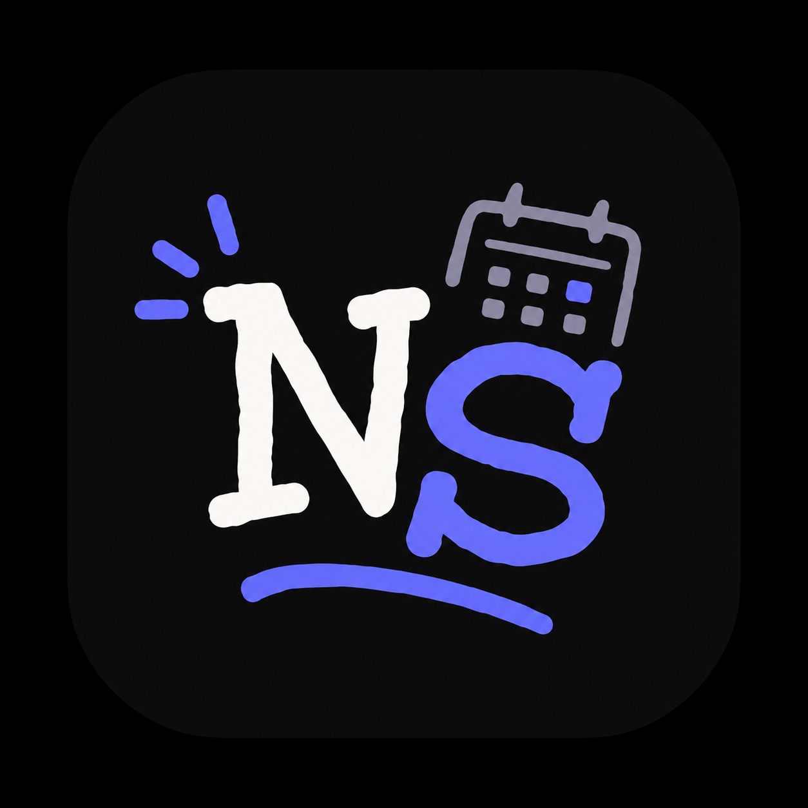
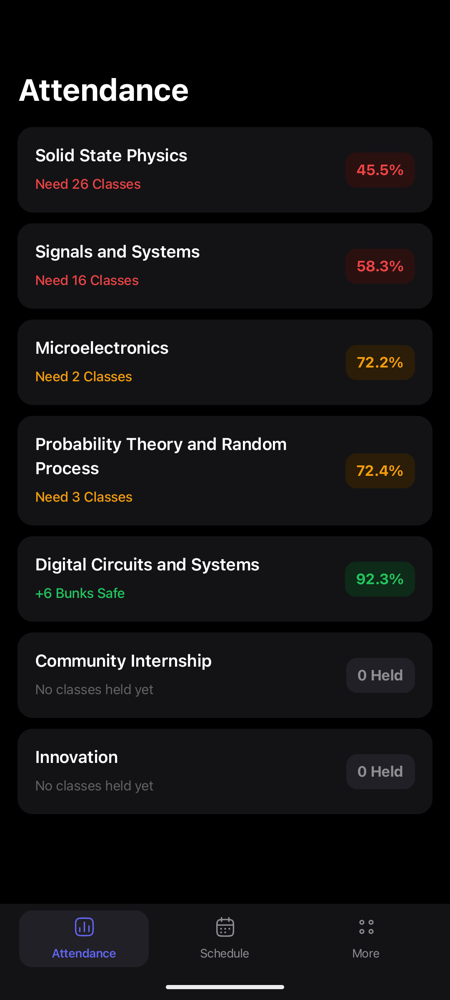
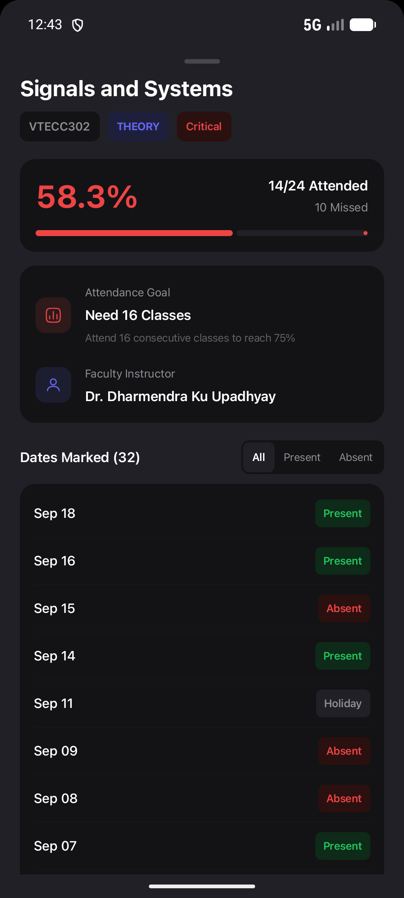
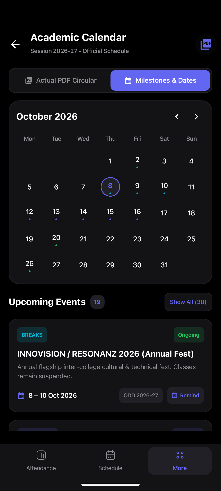
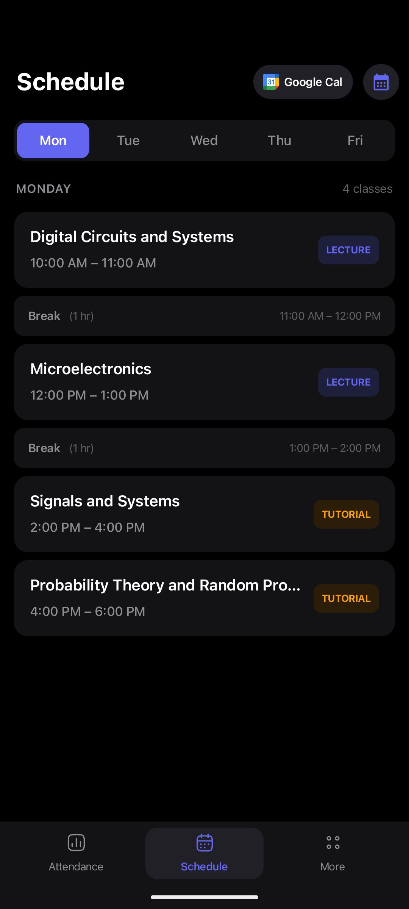
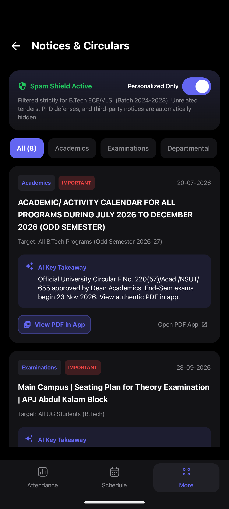
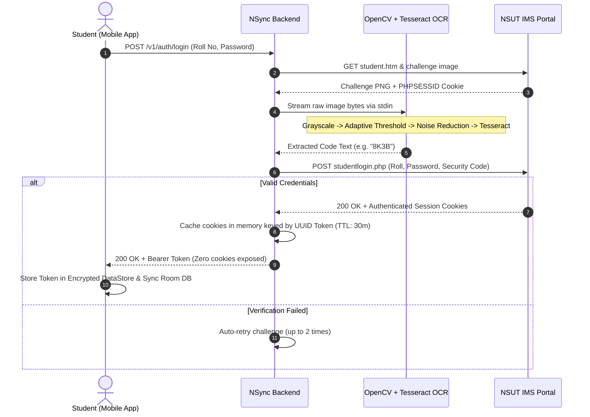

<div align="center">

  

  # NSync
  ### Academic Life, Seamlessly Synced.

  **The modern, all-in-one companion app for Netaji Subhas University of Technology (NSUT)**  
  *Seamless IMS Student Login • Smart 75% Attendance Bunk Engine • Dynamic Timetable & Google Calendar Sync • Exam Hall Seating Finder • Offline-First Architecture • Android Home Widgets*

  <br />

  [](https://github.com/senkuthegreat/NSync)
  [](https://kotlinlang.org)
  [](https://developer.android.com/jetpack/compose)
  [](https://nodejs.org)
  [](https://github.com/tesseract-ocr/tesseract)
  [](https://github.com/senkuthegreat/NSync)
  [](LICENSE)

  <br />

  <p align="center">
    <a href="docs/downloads/NSync.apk"><b>📥 Download Latest APK</b></a> •
    <a href="#-visual-tour"><b>📱 Visual Tour</b></a> •
    <a href="#-core-capabilities"><b>✨ Features</b></a> •
    <a href="#-attendance-math--bunk-engine"><b>🧮 Bunk Engine</b></a> •
    <a href="#-system-architecture"><b>🏗️ Architecture</b></a> •
    <a href="#-setup--installation"><b>🚀 Setup Guide</b></a> •
    <a href="#-author--connect"><b>👨‍💻 Developer</b></a>
  </p>

</div>

---

<p align="center">
  
</p>
<p align="center">
  <em>“Spend less time battling manual portal friction and attendance math — spend more time learning, creating, and living.”</em>
</p>

---

## 🌟 Overview

Every NSUT student knows the daily drill: wrestling with the sluggish **IMS portal**, repeatedly typing credentials on tiny mobile screens, guessing whether you have enough classes to bunk on Friday, hunting for lecture hall numbers in messy PDF circulars, and losing access whenever campus Wi-Fi drops.

**NSync** completely transforms this experience into a native, blazing-fast, and elegant student hub. Built from the ground up with **Jetpack Compose (Material 3)**, an **offline-first local database**, and an **OpenCV + Tesseract OCR pipeline**, NSync simplifies portal access, provides predictive attendance analytics, synchronizes timetables with your calendar, and puts your academic schedule right on your home screen.

---

## 📱 Visual Tour

<div align="center">
  <h3>✨ The Core Experience</h3>
</div>

<table align="center" width="100%">
  <tr>
    <td align="center" width="33%" valign="top">
      
      <br /><br />
      <b>📊 Smart Attendance Dashboard</b>
      <p><sub>Real-time subject percentages, overall aggregate, and instant dynamic safe bunk calculations.</sub></p>
    </td>
    <td align="center" width="33%" valign="top">
      
      <br /><br />
      <b>🗓️ Interactive Daily Timetable</b>
      <p><sub>Time-slot breakdowns, room numbers, lunch pauses, and single-tap Google Calendar export.</sub></p>
    </td>
    <td align="center" width="33%" valign="top">
      
      <br /><br />
      <b>🎓 Academic Hub & Tools</b>
      <p><sub>Semester SGPA/CGPA breakdowns, official academic calendar, notices, and exam seating finder.</sub></p>
    </td>
  </tr>
</table>

<br />

<div align="center">
  <h3>🔍 Detailed Insights & Circulars</h3>
</div>

<table align="center" width="100%">
  <tr>
    <td align="center" width="50%" valign="top">
      
      <br /><br />
      <b>📈 Subject Drill-Down & Bunk Simulator</b>
      <p><sub>Inspect attended vs. total lectures, safe margin thresholds, and projected future attendance before missing a class.</sub></p>
    </td>
    <td align="center" width="50%" valign="top">
      
      <br /><br />
      <b>📢 Official Notices & Circulars Feed</b>
      <p><sub>Direct feed of verified university notices, date sheets, holiday announcements, and event circulars.</sub></p>
    </td>
  </tr>
</table>

---

<p align="center">
  
</p>
<p align="center">
  <em>“Engineered for zero friction: every critical college vital accessible in milliseconds, online or offline.”</em>
</p>

---

## ✨ Core Capabilities

### 🛡️ 1. Persistent IMS Authentication & OCR Form Assistance
- **Single Sign-On Experience**: Log in once with your roll number and password. NSync securely caches your authorized session on-device.
- **Accessible OCR Pipeline**: Preprocesses and assists text extraction using **Python OpenCV** (adaptive thresholding, noise reduction) and **Tesseract OCR**.
- **Privacy-Guaranteed Session Store**: Raw credentials and IMS cookies never leak to client code or analytics; backend sessions use opaque, time-to-live UUID bearer tokens.

### 🧮 2. Smart 75% Criteria & Safe Bunk Engine
- **Instant Bunk Safety**: Dynamically calculates exactly how many consecutive lectures you can miss (`+X Bunks Safe`) without dropping below the university's mandatory 75% threshold.
- **Recovery Trajectory**: If you drop below 75%, it calculates the exact count of upcoming classes you must attend (`Need X Classes`) to safely recover.
- **Color-Coded Status Pill**: Instant visual health indicator (Emerald Green for Safe, Amber for Warning, Crimson for Danger).

### 🗓️ 3. Daily Timetables & 1-Tap Google Calendar Export
- **Smart Schedule Layout**: Displays today's lectures, subject codes, faculty details, and designated hall/room numbers.
- **Break & Gap Awareness**: Highlights lunch hours and free blocks so you can plan study or club sessions effortlessly.
- **Calendar Integration**: Exports recurring semester schedules directly into **Google Calendar** with configurable 10-minute reminders.

### 🏆 4. Semester Results & CGPA Analytics
- Comprehensive SGPA breakdowns for every completed semester.
- Cumulative CGPA trajectory tracking with credit-weight calculations.
- Instant access to subject-wise grade sheets and marks distribution.

### 🎫 5. Admit Card & Exam Seating Finder
- **Roll Number Lookup**: Find your designated examination block, room, floor, and desk number in seconds without combing through 100-page PDF circulars.
- Supports both **Mid-Semester** and **End-Semester** examination shifts.

### 📱 6. Glance Android Home Screen Widgets
- Rich Android app widgets built with Jetpack Glance.
- View upcoming lecture times and real-time attendance percentage directly from your home screen.

### 📴 7. 100% Offline-First Architecture
- Full local SQLite persistence powered by **Room Database**.
- Access your complete timetable, room numbers, and cached attendance even in underground labs, basements, or during network outages.

---

## 🧮 Attendance Math & Bunk Engine

NSync implements rigorous predictive mathematics so students can make informed decisions without pen-and-paper guesswork:

Let $A$ be the number of classes attended, and $T$ be the total classes conducted. The current percentage $P$ is:

$$P = \left( \frac{A}{T} \right) \times 100$$

### Case 1: You are above 75% ($P \ge 75\%$)
How many consecutive classes $B$ can you safely bunk without dropping below 75%?

$$\frac{A}{T + B} \ge 0.75 \implies B \le \frac{A - 0.75 T}{0.75}$$

$$\mathbf{Safe\ Bunks} = \left\lfloor \frac{4A - 3T}{3} \right\rfloor$$

### Case 2: You are below 75% ($P < 75\%$)
How many consecutive classes $C$ must you attend to restore your attendance to at least 75%?

$$\frac{A + C}{T + C} \ge 0.75 \implies 0.25 C \ge 0.75 T - A$$

$$\mathbf{Classes\ Needed} = \left\lceil \frac{3T - 4A}{1} \right\rceil = \lceil 3T - 4A \rceil$$

---

<p align="center">
  
</p>
<p align="center">
  <em>“A modular, memory-efficient full-stack architecture built for speed and security.”</em>
</p>

---

## 🏗️ System Architecture

```
┌─────────────────────────────────────────────────────────────────────────────┐
│                            NSync Mobile App (Android)                       │
│     Jetpack Compose  •  Material 3  •  Room SQLite  •  Glance Widgets       │
└──────────────────────────────────────┬──────────────────────────────────────┘
                                       │
                      HTTP / JSON (Bearer Token Auth)
                                       │
                                       ▼
┌─────────────────────────────────────────────────────────────────────────────┐
│                            NSync Backend Service                            │
│                  Node.js  •  Express.js  •  UUID Session Store              │
├──────────────────────────────────────┬──────────────────────────────────────┤
│                                      │                                      │
│  [Headless OCR Service]              │  [IMS Reverse Proxy]                 │
│  • Python OpenCV Stream              │  • Session Cookie Persistence        │
│  • UB-Mannheim Tesseract OCR         │  • HTML Parsing & Normalization      │
│  • Stdin/Stdout Zero-Disk Pipes      │  • Smart Form Assistant              │
└──────────────────┬───────────────────┴───────────────────┬──────────────────┘
                   │                                       │
                   ▼                                       ▼
         [Local OCR Engine]                       [Official NSUT IMS]
       Grayscale + Adaptive Thresh              imsnsit.org/imsnsit
```

### Authentication & OCR Assistant Flow



---

## 🛠️ Technology Stack

| Layer | Technologies | Highlights |
| :--- | :--- | :--- |
| **Android Client** | Kotlin 2.0, Jetpack Compose, Material 3, Coroutines, StateFlow | 60/120 FPS fluid UI, dynamic color theming, gesture-driven bottom sheets |
| **Local Storage** | Room Database, SQLite, Encrypted DataStore | 100% offline access, reactive query observers |
| **Android Widgets**| Jetpack Glance API, RemoteViews | Real-time attendance % and next lecture displayed on home screen |
| **Backend API** | Node.js, Express.js | Memory-efficient streaming, opaque UUID token session store |
| **Vision / OCR** | Python 3.9+, OpenCV (`cv2`), Tesseract OCR | Adaptive thresholding, contrast enhancement, stdin/stdout zero-tempfile pipes |
| **Web Showcase** | React 18, Vite, Lucide Icons, Vanilla CSS | Glassmorphic design, mobile-first responsive layout, APK direct delivery |
| **Deployment** | Vercel Edge, Ubuntu Container / Windows Service | Edge caching, instant global CDN delivery |

---

<p align="center">
  
</p>
<p align="center">
  <em>“Set up in minutes — whether you want the pre-built APK or want to contribute to the codebase.”</em>
</p>

---

## 🚀 Setup & Installation

### Option 1: Install Pre-Built Android APK (For Students)

1. Download the latest release: [`NSync.apk`](docs/downloads/NSync.apk) directly from this repository or the web showcase.
2. Open the downloaded file on your Android device (Android 7.0+ / Nougat or newer).
3. Tap **Install** (allow *Install from Unknown Sources* if prompted).
4. Launch NSync, enter your IMS credentials once, and enjoy instant synchronized access!

---

### Option 2: Build from Source (For Developers)

#### Prerequisites
- **Android Studio**: Ladybug (2024.2+) or newer with Android SDK 36
- **JDK**: Java 17 or Java 21
- **Node.js**: v18.0.0 or later (v20+ recommended)
- **Python**: 3.9+ with `opencv-python`, `numpy`, `pillow`
- **Tesseract OCR**:
  - **Windows**: `winget install --id UB-Mannheim.TesseractOCR -e`
  - **Linux / macOS**: `sudo apt install tesseract-ocr` or `brew install tesseract`

#### 1. Clone the Repository
```bash
git clone https://github.com/senkuthegreat/NSync.git
cd NSync
```

#### 2. Run the Backend & OCR Service
```bash
cd server
npm install

# Setup environment variables
cp .env.example .env

# Verify Python requirements
pip install opencv-python numpy pillow

# Start development server
npm run dev
```

#### 3. Build & Run the Android Application
Open the root project in **Android Studio**:
```bash
# Or build via terminal
./gradlew assembleDebug

# Install directly to a connected device or running emulator
./gradlew installDebug
```

#### 4. Run the Web Showcase & Landing Portal
```bash
cd web
npm install
npm run dev
```

---

## ⚙️ Backend Environment Variables

Configure your `server/.env` file to customize backend behavior:

| Variable | Default Value | Description |
| :--- | :--- | :--- |
| `PORT` | `3000` | Port on which the Express server listens. |
| `NODE_ENV` | `development` | Runtime environment (`development`, `production`, `test`). |
| `IMS_BASE_URL` | `https://www.imsnsit.org/imsnsit` | Official NSUT IMS root portal URL. |
| `IMS_MOCK` | `false` | Enable deterministic mock responses for offline development and testing. |
| `SESSION_TTL_MINUTES` | `30` | In-memory lifetime for cached IMS portal sessions. |
| `TESSERACT_PATH` | System default or `C:\Program Files\Tesseract-OCR\tesseract.exe` | Absolute path to the Tesseract OCR executable. |
| `OCR_TIMEOUT_MS` | `10000` | Watchdog timeout for OCR preprocessing and recognition. |

---

## 📂 Repository Structure

```
NSync/
├── app/                               # 📱 Android Client Source Code
│   ├── src/main/java/com/example/nsutconnect/
│   │   ├── data/                      # Repositories, Room DB, Network, Sync
│   │   ├── theme/                     # Material 3 Color palette, Typography, Transitions
│   │   ├── ui/                        # Jetpack Compose Screens
│   │   │   ├── attendance/            # Attendance tracker & drill-down sheets
│   │   │   ├── schedule/              # Timetable slots & day filters
│   │   │   ├── notices/               # Circulars & announcements
│   │   │   ├── calendar/              # Academic calendar view
│   │   │   ├── exam/                  # Admit card & seating locator
│   │   │   └── more/                  # Settings, results & tools hub
│   │   └── widget/                    # Glance Android Home Screen Widgets
│   └── build.gradle.kts               # Android dependencies & build config
├── server/                            # ⚡ Express.js Backend & OCR Microservice
│   ├── src/
│   │   ├── ims/                       # IMS portal client, session store & scraping
│   │   ├── ocr/                       # OpenCV image preprocessing & Tesseract engine
│   │   ├── routes/                    # API endpoints (/auth, /academic, /ocr)
│   │   └── server.js                  # Entry point
│   ├── test/                          # Unit and integration test suites
│   └── package.json
├── web/                               # 🌐 Web Showcase & Live Portal
│   ├── src/                           # React 18, Vite & Glassmorphism UI
│   └── package.json
├── docs/                              # 📖 GitHub Pages / Vercel Web Deployment
│   ├── assets/
│   │   ├── artworks/                  # 🎨 High-resolution artwork banners
│   │   ├── screenshots/               # 📱 Curated Android app captures
│   │   └── logo.png                   # Official NSync high-res logo
│   └── downloads/
│       └── NSync.apk                  # Direct downloadable release package
└── README.md                          # 📄 Project documentation & showcase
```

---

<p align="center">
  
</p>
<p align="center">
  <em>“Built with care and attention to detail for the NSUT student community.”</em>
</p>

---

## 👨‍💻 Author & Connect

Designed, architected, and maintained with ❤️ by **Rohit Dahiya**:

<div align="center">

  

  ### **Rohit Dahiya**
  `@senkuthegreat`

  [](https://senkuthegreat.me)
  [](https://github.com/senkuthegreat)
  [](https://www.linkedin.com/in/rohit-dahiya-14b180240/)
  [](https://instagram.com/senkuthegreat)
  [](mailto:rohitdahiya245@gmail.com)

</div>

---

## 🤝 Contributing

Contributions, feedback, and bug reports are warmly welcome!

1. **Fork the Repository**
2. **Create a Feature Branch** (`git checkout -b feat/amazing-feature`)
3. **Commit your Changes** (`git commit -m 'feat: Add amazing feature'`)
4. **Push to the Branch** (`git push origin feat/amazing-feature`)
5. **Open a Pull Request**

If you encounter any bugs or have feature ideas, feel free to open an [Issue](https://github.com/senkuthegreat/NSync/issues).

---

## 📜 Disclaimer & License

> [!NOTE]  
> **NSync** is an independent, student-developed open source companion tool and is not officially affiliated with, endorsed by, or operated by Netaji Subhas University of Technology (NSUT). All trademarks, logos, and portal rights belong to their respective owners.

This project is licensed under the [MIT License](LICENSE) — free to use, modify, and distribute.

<br />

<div align="center">
  <sub>Made with ☕ and passion by <a href="https://github.com/senkuthegreat">Rohit Dahiya</a>. If NSync helps your semester, consider giving it a ⭐ on GitHub!</sub>
</div>
